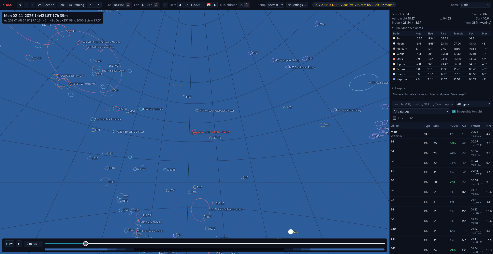
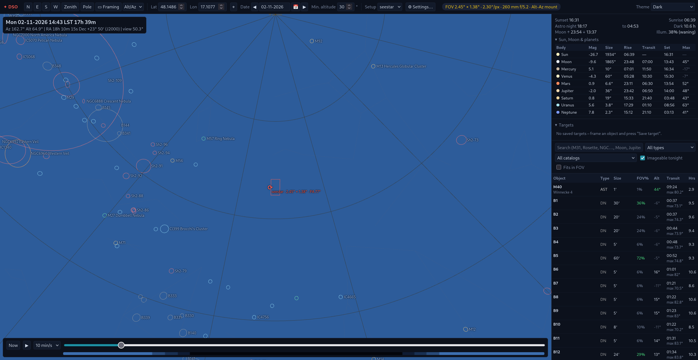
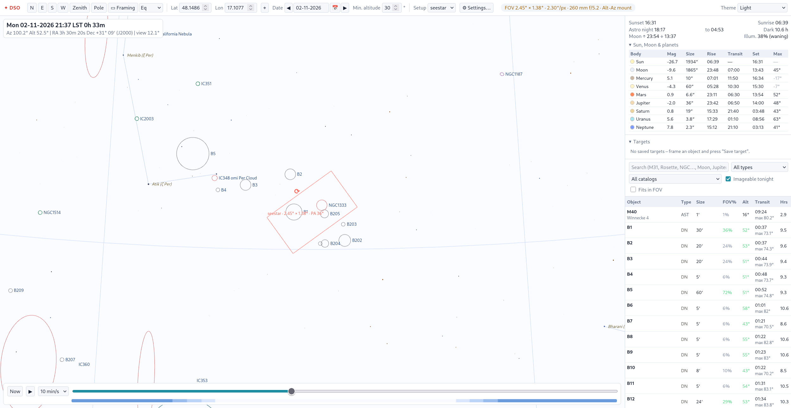
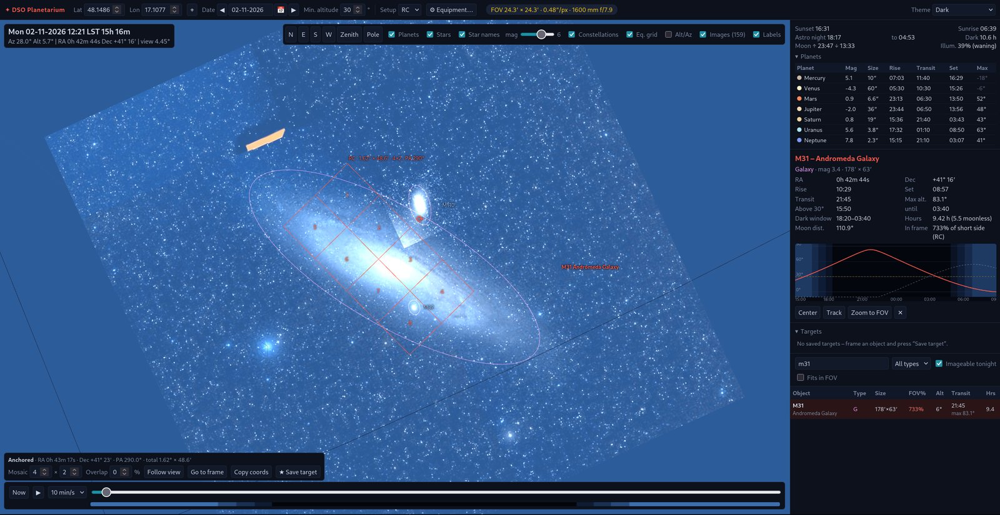

# DSO Planetarium

A web-based planetarium and planner for **deep-sky astrophotography**, built with FastAPI and Three.js.
It focuses on what an imager needs: where deep-sky objects are, when they rise, transit and set, how long
they stay high in true darkness, and how they fit the field of view of your telescope + camera.

  

## Screenshots

<p>
  
  
</p>

*View modes on the same part of the sky: **Equatorial** (left — celestial north up, RA/Dec grid, the sky stays fixed while
time runs) and **Alt/Az** (right — zenith up, Alt/Az grid). OpenNGC, Sharpless and Barnard catalogs, the "Sun, Moon &
planets" table and the view controls in the header.*


*Light theme with inverted sky colours (white background, black stars) — Barnard dark nebulae around NGC 1333 in
Perseus and the field of a Seestar S50 Pro on its alt-az mount, rotated against the stars in the equatorial view.*


*Mosaic: a 4×2 mosaic over M31 at PA 290°, drawn on the sky over the DSS image; panels are numbered and the frame can be dragged and rotated.*

## Features

**3D sky**
- Observer-centred celestial sphere with horizon, cardinal points, zenith and celestial-pole markers
- Everything is shown at its position of date (precession applied to the J2000 data); coordinates are displayed in J2000
- Two view modes: Alt/Az (zenith up) and Equatorial (celestial north up, sky fixed while time runs); grid of the current mode
- Horizon can be hidden to see objects below it
- **Esc** clears the selection; the FOV frame then follows the view again
- Constellation lines
- ~41 000 stars down to mag 8 with B−V colours; limiting magnitude slider that deepens as you zoom
- Names of bright stars (proper names; Bayer designations when zoomed in)
- Sun, Moon (with illumination) and planets Mercury–Neptune with true angular sizes
- Drag to look around, mouse wheel to zoom from 110° down to 0.15°

**Deep-sky objects**
- Manageable catalogs (⚙ Settings › Catalogs): show / hide, import your own (CSV / JSON), delete. Built in:
  - [OpenNGC](https://github.com/mattiaverga/OpenNGC) — 1 027 NGC/IC objects incl. all Messier objects (≤ 11 mag, ≥ 8′ or named),
    with accurate sizes and position angles
  - OpenNGC faint — 2 143 more NGC/IC objects between 11 and 13 mag, mostly galaxies (for stacked imaging, e.g. Seestar)
  - Sharpless (Sh2) — 313 emission nebulae; Barnard (B) — 349 dark nebulae
  - a few extra hand-picked targets
- The same object listed under different ids in several catalogs (Sh2-117 = NGC 7000) is shown once;
  the other ids become searchable aliases
- Object types can be shown / hidden (⚙ Settings › Objects); the table can be filtered by type and catalog
- Density control: at wide views only objects large on screen or bright enough are drawn, more appear as you zoom in
- Each object drawn as an ellipse with its real angular size and position angle, colour-coded by type
- Local sky images (DSS2 colour) overlaid at the correct scale and orientation
- Labels placed to the right of each object, like Stellarium/KStars

**Planning**
- Time slider across the night, "Now", animated playback; twilight bar (civil / nautical / astronomical)
- Night summary: sunset/sunrise, astronomical darkness, dark hours, Moon rise/set and phase
- Object table: current altitude, transit time and max altitude, imageable hours (dark + above min. altitude),
  object size as % of the sensor; sort, search, type filter, "imageable tonight", "fits in FOV"
- Object detail: rise/transit/set, time above minimum altitude, dark window, moonless hours,
  distance from the Moon, nightly altitude chart (imageable window, Moon, meridian, horizon profile, airmass axis)
- Custom horizon profile (⚙ Settings › Horizon; trees, buildings): drawn on the sky, used for imageable hours;
  import from Stellarium `.txt`, NINA `.hrz` or CSV
- "Sun, Moon & planets" table with magnitude, size, rise/transit/set and max altitude in darkness
- Search finds deep-sky objects (also by alias), the Sun, the Moon and planets
- Center / track / zoom-to-FOV for any object, planet, the Sun or the Moon

**Equipment**
- Equipment (⚙ Settings › Equipment) with any number of telescope + camera setups: focal length, reducer/Barlow, aperture,
  sensor size (camera presets incl. Seestar S50 / S50 Pro), pixel size, mount, rotation, frame colour
- Computed effective focal length, f-ratio, FOV, image scale (″/px) and resolution
- Active setup shown as a FOV frame drawn on the sky; other setups can be shown simultaneously as dashed frames
- Equatorial or Alt-Az mount per setup — on an equatorial mount the frame keeps its position angle and turns with the sky;
  on an alt-az mount (e.g. Seestar) it stays level with the horizon and rotates against the stars (field rotation)
- Drag the frame to compose the shot, drag the ⟳ handle to rotate the camera (position angle N→E)
- Mosaics: columns × rows with overlap; copy panel centres (RA/Dec/PA) for NINA / Ekos / ASIAIR
- Saved targets: store a framed object (centre, PA, setup, mosaic) and reload it later; available via the API

**Performance**
- The sky is redrawn only when something changes — an idle window uses almost no CPU / GPU
- Lightweight label layer, culling of objects outside the view, matrix updates only for visible objects, paged object
  table, NumPy-vectorised server computations with gzip — about 4 ms CPU per frame with ~3 800 objects
- Settings › Performance: hardware-GPU or software (CPU) mode, GPU preference, resolution, antialiasing, frame-rate cap

**UI**
- Uncluttered sky: view controls (N / E / S / W, Zenith, Pole, ▭ Framing, Alt/Az ↔ Eq) are in the header;
  display toggles are in ⚙ Settings › Display
- The framing & mosaic panel appears only when turned on (▭ Framing, shortcut **F**)
- Shortcuts: **← ↑ → ↓** pan the sky (**Shift** = fine) · **+ / −** zoom · **T** theme · **I** invert colours ·
  **F** framing panel · **Esc** clear selection
- Dark, Light and Red (night-vision) themes — press **T** to cycle
- Inverted sky colours (white background, black stars) like a printed chart — press **I**
- Date as dd-mm-yyyy with calendar and previous/next-night buttons
- Setups and targets are stored on the server (SQLite), so any client — or an external controller — can use them via the API
- Every setting is remembered: view preferences (theme, toggles, filters, performance, …) are saved in the browser and
  on the server, so they are restored on the next start — also in another browser

## Quick start

```bash
python3 -m venv .venv
.venv/bin/pip install -r requirements.txt
.venv/bin/uvicorn app.main:app --reload
```
Open <http://127.0.0.1:8000>.

The app runs fully offline: all libraries (Three.js in `static/vendor/`), the catalog, stars and images are served locally.
Internet is needed only to run `tools/download_images.py`.

## Images

Images live in `images/`, the file name is the object ID: `images/M31.jpg` (jpg / png / webp).

Optional sidecar `images/M31.json` for your own photos:
```json
{"fov": 3.2, "rot": 15, "ra": 10.68, "dec": 41.27}
```
| key | meaning | default |
|---|---|---|
| `fov` | image width in degrees | 1.6 × object size |
| `rot` | rotation of north from the top edge towards east, degrees | 0 |
| `ra`, `dec` | image centre, degrees J2000 | object position |

Fill the folder with DSS2 images from NASA SkyView (Red + Blue composed into colour locally):
```bash
.venv/bin/python tools/download_images.py --catalog openngc     # one catalog
.venv/bin/python tools/download_images.py --only M31 M42 --px 1024 --force
```
Existing files — including your own photos — are never overwritten without `--force`.
The bundled set covers the original ~160 targets; running the script without `--only` downloads images
for every catalog (≈ 3 800 objects, several hundred MB) — usually limit it with `--catalog openngc` or `--only`.

## Project layout

```
app/
  main.py        FastAPI app and API endpoints
  astro.py       Sun/Moon/sidereal time, precession, rise-transit-set, darkness window, horizon (no dependencies)
  catalog.py     catalog management: loading, merging by priority, import, delete
  data/catalogs/ one JSON file per catalog (OpenNGC, Sharpless, Barnard, extras, your imports)
  images.py      local image index
  store.py       SQLite storage for setups, targets and settings
  framing.py     FOV / mosaic geometry (panel centres)
static/
  index.html, style.css           page and styles
  js/            ES modules of the UI:
    boot.js        loads the saved UI preferences from the server, then starts main.js
    main.js        entry point, initialises the modules in order
    core.js        shared state, helpers, equipment model
    scene.js       Three.js scene, sky orientation, camera and mouse controls
    objects.js     stars, constellations, planets, deep-sky objects, images
    framing.js     FOV frame and mosaic on the sky (drag / rotate)
    loop.js        render loop, label decluttering, HUD
    panels.js      night summary, object table, details, altitude chart
    time.js        date / time controls
    settings.js    Settings › Equipment, toggles, theme
    sync.js        server sync of setups
    targets.js     saved targets
    horizon.js     Settings › Horizon (profile, silhouette, parser)
    dialog.js      Settings dialog with tabs
    objtypes.js    Settings › Objects (visible types, density)
    catalogs.js    Settings › Catalogs (show / hide, import, delete)
    perf.js        Settings › Performance (GPU, quality, frame rate)
    labels.js      lightweight HTML label layer (replaces CSS2DRenderer)
  astro.js       client-side astronomy incl. planets (JPL Keplerian elements) and precession
  data/          stars, star names, constellation lines
  vendor/        third-party libraries (three.js)
tools/
  build_catalog.py     builds app/data/catalogs/openngc.json from OpenNGC
  build_vizier.py      builds the Sharpless and Barnard catalogs from CDS VizieR
  download_images.py   fills images/ from NASA SkyView
tests/           pytest suite (accuracy vs astropy, JS parity, API)
images/          object images
data/            SQLite database (created on first run, not in git)
```

## API

| endpoint | description |
|---|---|
| `GET /api/catalog` | objects of visible catalogs and types (with `cat`, `aka`), type names and counts, catalog list |
| `GET /api/catalogs` | catalogs with counts, priority, source, license, hidden flag |
| `POST /api/catalogs` | import a catalog (multipart: `file` CSV/JSON, `id`, `name`, `priority`, …; `replace=true` to overwrite) |
| `DELETE /api/catalogs/{id}` | delete a catalog file |
| `GET /api/night?lat&lon&start` | Sun twilight times, Moon rise/set/illumination, dark hours |
| `GET /api/visibility?lat&lon&start&min_alt&twilight` | night summary + per-object visibility |
| `GET /api/images` | objects with a local image and its fov/rotation/centre |
| `GET /api/image/{id}` | the image file |
| `GET POST /api/setups`, `GET PUT DELETE /api/setups/{id}` | equipment setups (stored on the server) |
| `GET POST /api/targets`, `GET PUT DELETE /api/targets/{id}` | planned targets: frame centre, PA, setup, mosaic, notes |
| `GET /api/targets/{id}/panels` | mosaic panel centres (RA/Dec J2000, PA) — ready for a capture or mount controller |
| `GET PATCH /api/settings` | server-side settings (`active_setup`, `horizon` = list of `[azimuth, altitude]`, `hidden_catalogs`, `hidden_types`, `ui` = browser UI preferences) |

Interactive API documentation (OpenAPI) is available at <http://127.0.0.1:8000/docs>.
Setups and targets are stored in `data/astro.db` (SQLite); back up that file to keep your plans.

`start` is the beginning of the 24 h window (local noon) in ISO 8601.

## Accuracy

Computations are self-contained and intended for planning. Measured against astropy
(`pytest`, 3 sites × 5 dates 2020–2035, geometric altitude):

| | max. error |
|---|---|
| deep-sky objects (J2000 catalog, precessed to date) | 0.5′ |
| Sun | 0.3′ |
| Moon (topocentric) | 13′ |
| planets | 1–2′ (Saturn 5′) |
| rise / set / twilight times | < 2 min |

Rise and set of deep-sky objects use the standard altitude −0.57° (refraction at the horizon).

## Tests

```bash
.venv/bin/pip install -r requirements-dev.txt
.venv/bin/python -m pytest
```
The suite compares `app/astro.py` and `static/astro.js` with astropy, checks that the Python and JavaScript
implementations agree, and exercises the REST API. JavaScript tests need Node.js.

## Data credits

- Deep-sky catalog: [OpenNGC](https://github.com/mattiaverga/OpenNGC) by Mattia Verga, CC BY-SA 4.0 —
  `app/data/catalogs/openngc.json` is an adaptation and is distributed under the same license (see `app/data/README.md`)
- Sharpless (1959) and Barnard (1927) catalogs via CDS VizieR (VII/20, VII/220A). *This research has made use of the
  VizieR catalogue access tool, CDS, Strasbourg, France.*

- Stars, star names and constellation lines: [d3-celestial](https://github.com/ofrohn/d3-celestial) © 2015 Olaf Frohn,
  BSD 3-Clause License — see [`static/data/LICENSE-d3-celestial.txt`](static/data/LICENSE-d3-celestial.txt); derived from Hipparcos/Tycho (ESA)
- Images: Digitized Sky Survey (DSS2) via [NASA SkyView](https://skyview.gsfc.nasa.gov/) — see the DSS acknowledgement terms
- Planetary elements: E. M. Standish, *Keplerian Elements for Approximate Positions of the Major Planets* (JPL)
- Planet magnitudes: Mallama & Hilton (2018)
- [three.js](https://threejs.org/) 0.160.0, MIT License — bundled in `static/vendor/three/`

## License

[MIT](LICENSE) © 2026 krse

The MIT license covers the source code of this project; `app/data/catalogs/openngc*.json` are CC BY-SA 4.0. Bundled third-party data keep their own licenses
(see *Data credits* above and [`static/data/README.md`](static/data/README.md)).
