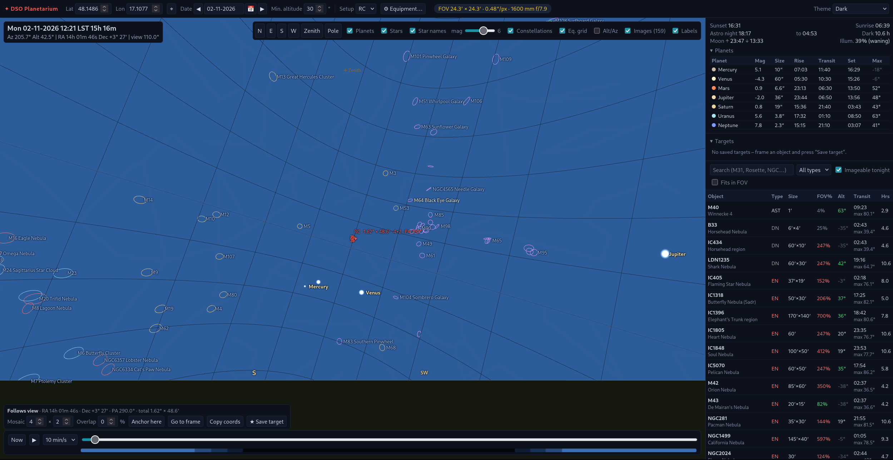

# DSO Planetarium

A web-based planetarium and planner for **deep-sky astrophotography**, built with FastAPI and Three.js.
It focuses on what an imager needs: where deep-sky objects are, when they rise, transit and set, how long
they stay high in true darkness, and how they fit the field of view of your telescope + camera.

  

## Screenshots


*Dark theme: deep-sky objects with true sizes and DSS images, star names, constellations, Uranus selected with its planet detail.*


*Object table, night summary and M31 with its nightly altitude chart.*


*Light theme: Rosette Nebula with a local DSS2 image and the FOV frame of a 1600 mm RC + ASI533.*


*Mosaic: a 4×2 mosaic over M31 at PA 290°, drawn on the sky over the DSS image; panels are numbered and the frame can be dragged and rotated.*


*Framing panel (bottom left): frame centre and PA, mosaic size and overlap, anchor / follow view, copy coordinates, save target; the Targets list is in the side panel.*


*Planets: Jupiter centred in the FOV frame, disc size on the sensor, rise/transit/set for all planets.*


*Red theme for use at the telescope — the whole UI and the sky are rendered in red only.*

<p>
  
  
</p>

*Equipment dialog: setups with focal length, reducer, camera preset, and computed FOV, f-ratio and image scale.*

## Features

**3D sky**
- Observer-centred celestial sphere with horizon, cardinal points, zenith and celestial-pole markers
- Everything is shown at its position of date (precession applied to the J2000 data); coordinates are displayed in J2000
- Equatorial grid, optional Alt/Az grid, constellation lines
- ~41 000 stars down to mag 8 with B−V colours; limiting magnitude slider that deepens as you zoom
- Names of bright stars (proper names; Bayer designations when zoomed in)
- Sun, Moon (with illumination) and planets Mercury–Neptune with true angular sizes
- Drag to look around, mouse wheel to zoom from 110° down to 0.15°

**Deep-sky objects**
- Catalog of 1 036 objects from [OpenNGC](https://github.com/mattiaverga/OpenNGC): all Messier objects, everything brighter
  than 11 mag, larger than 8′ or with a common name — with accurate sizes and position angles; plus a few Sh2/LDN targets
- Each object drawn as an ellipse with its real angular size and position angle, colour-coded by type
- Local sky images (DSS2 colour) overlaid at the correct scale and orientation
- Labels placed to the right of each object, like Stellarium/KStars

**Planning**
- Time slider across the night, "Now", animated playback; twilight bar (civil / nautical / astronomical)
- Night summary: sunset/sunrise, astronomical darkness, dark hours, Moon rise/set and phase
- Object table: current altitude, transit time and max altitude, imageable hours (dark + above min. altitude),
  object size as % of the sensor; sort, search, type filter, "imageable tonight", "fits in FOV"
- Object detail: rise/transit/set, time above minimum altitude, dark window, moonless hours,
  distance from the Moon, nightly altitude chart (imageable window, Moon, meridian, horizon profile, airmass axis)
- Custom horizon profile (trees, buildings): drawn on the sky, used for imageable hours;
  import from Stellarium `.txt`, NINA `.hrz` or CSV
- Planets table with magnitude, size, rise/transit/set and max altitude in darkness
- Center / track / zoom-to-FOV for any object or planet

**Equipment**
- Equipment dialog with any number of telescope + camera setups: focal length, reducer/Barlow, aperture,
  sensor size (camera presets), pixel size, rotation, frame colour
- Computed effective focal length, f-ratio, FOV, image scale (″/px) and resolution
- Active setup shown as a FOV frame drawn on the sky; other setups can be shown simultaneously as dashed frames
- Equatorial or Alt-Az mount per setup — on an equatorial mount the frame keeps its position angle and turns with the sky
- Drag the frame to compose the shot, drag the ⟳ handle to rotate the camera (position angle N→E)
- Mosaics: columns × rows with overlap; copy panel centres (RA/Dec/PA) for NINA / Ekos / ASIAIR
- Saved targets: store a framed object (centre, PA, setup, mosaic) and reload it later; available via the API

**UI**
- Dark, Light and Red (night-vision) themes — press **T** to cycle
- Date as dd-mm-yyyy with calendar and previous/next-night buttons
- Setups and targets are stored on the server (SQLite), so any client — or an external controller — can use them via the API;
  view preferences (theme, location, toggles) stay in the browser

## Quick start

```bash
python3 -m venv .venv
.venv/bin/pip install -r requirements.txt
.venv/bin/uvicorn app.main:app --reload
```
Open <http://127.0.0.1:8000>.

The app runs fully offline: all libraries (Three.js in `static/vendor/`), the catalog, stars and images are served locally.
Internet is needed only to run `tools/download_images.py`.

## Images

Images live in `images/`, the file name is the object ID: `images/M31.jpg` (jpg / png / webp).

Optional sidecar `images/M31.json` for your own photos:
```json
{"fov": 3.2, "rot": 15, "ra": 10.68, "dec": 41.27}
```
| key | meaning | default |
|---|---|---|
| `fov` | image width in degrees | 1.6 × object size |
| `rot` | rotation of north from the top edge towards east, degrees | 0 |
| `ra`, `dec` | image centre, degrees J2000 | object position |

Fill the folder with DSS2 images from NASA SkyView (Red + Blue composed into colour locally):
```bash
.venv/bin/python tools/download_images.py                      # whole catalog
.venv/bin/python tools/download_images.py --only M31 M42 --px 1024 --force
```
Existing files — including your own photos — are never overwritten without `--force`.
The bundled set covers the original ~160 targets; running the script without `--only` downloads images
for the whole 1 036-object catalog (roughly 200 MB, it takes a while).

## Project layout

```
app/
  main.py        FastAPI app and API endpoints
  astro.py       Sun/Moon/sidereal time, precession, rise-transit-set, darkness window, horizon (no dependencies)
  catalog.py     deep-sky catalog loader (+ fallback entries)
  data/          catalog.json built from OpenNGC
  images.py      local image index
  store.py       SQLite storage for setups, targets and settings
  framing.py     FOV / mosaic geometry (panel centres)
static/
  index.html, style.css           page and styles
  js/            ES modules of the UI:
    main.js        entry point, initialises the modules in order
    core.js        shared state, helpers, equipment model
    scene.js       Three.js scene, sky orientation, camera and mouse controls
    objects.js     stars, constellations, planets, deep-sky objects, images
    framing.js     FOV frame and mosaic on the sky (drag / rotate)
    loop.js        render loop, label decluttering, HUD
    panels.js      night summary, object table, details, altitude chart
    time.js        date / time controls
    settings.js    equipment dialog, toggles, theme
    sync.js        server sync of setups
    targets.js     saved targets
    horizon.js     custom horizon profile (dialog, silhouette, parser)
  astro.js       client-side astronomy incl. planets (JPL Keplerian elements) and precession
  data/          stars, star names, constellation lines
  vendor/        third-party libraries (three.js)
tools/
  build_catalog.py     builds app/data/catalog.json from OpenNGC
  download_images.py   fills images/ from NASA SkyView
tests/           pytest suite (accuracy vs astropy, JS parity, API)
images/          object images
data/            SQLite database (created on first run, not in git)
```

## API

| endpoint | description |
|---|---|
| `GET /api/catalog` | object catalog and type names |
| `GET /api/night?lat&lon&start` | Sun twilight times, Moon rise/set/illumination, dark hours |
| `GET /api/visibility?lat&lon&start&min_alt&twilight` | night summary + per-object visibility |
| `GET /api/images` | objects with a local image and its fov/rotation/centre |
| `GET /api/image/{id}` | the image file |
| `GET POST /api/setups`, `GET PUT DELETE /api/setups/{id}` | equipment setups (stored on the server) |
| `GET POST /api/targets`, `GET PUT DELETE /api/targets/{id}` | planned targets: frame centre, PA, setup, mosaic, notes |
| `GET /api/targets/{id}/panels` | mosaic panel centres (RA/Dec J2000, PA) — ready for a capture or mount controller |
| `GET PATCH /api/settings` | server-side settings (`active_setup`, `horizon` = list of `[azimuth, altitude]`) |

Interactive API documentation (OpenAPI) is available at <http://127.0.0.1:8000/docs>.
Setups and targets are stored in `data/astro.db` (SQLite); back up that file to keep your plans.

`start` is the beginning of the 24 h window (local noon) in ISO 8601.

## Accuracy

Computations are self-contained and intended for planning. Measured against astropy
(`pytest`, 3 sites × 5 dates 2020–2035, geometric altitude):

| | max. error |
|---|---|
| deep-sky objects (J2000 catalog, precessed to date) | 0.5′ |
| Sun | 0.3′ |
| Moon (topocentric) | 13′ |
| planets | 1–2′ (Saturn 5′) |
| rise / set / twilight times | < 2 min |

Rise and set of deep-sky objects use the standard altitude −0.57° (refraction at the horizon).

## Tests

```bash
.venv/bin/pip install -r requirements-dev.txt
.venv/bin/python -m pytest
```
The suite compares `app/astro.py` and `static/astro.js` with astropy, checks that the Python and JavaScript
implementations agree, and exercises the REST API. JavaScript tests need Node.js.

## Data credits

- Deep-sky catalog: [OpenNGC](https://github.com/mattiaverga/OpenNGC) by Mattia Verga, CC BY-SA 4.0 —
  `app/data/catalog.json` is an adaptation and is distributed under the same license (see `app/data/README.md`)

- Stars, star names and constellation lines: [d3-celestial](https://github.com/ofrohn/d3-celestial) © 2015 Olaf Frohn,
  BSD 3-Clause License — see [`static/data/LICENSE-d3-celestial.txt`](static/data/LICENSE-d3-celestial.txt); derived from Hipparcos/Tycho (ESA)
- Images: Digitized Sky Survey (DSS2) via [NASA SkyView](https://skyview.gsfc.nasa.gov/) — see the DSS acknowledgement terms
- Planetary elements: E. M. Standish, *Keplerian Elements for Approximate Positions of the Major Planets* (JPL)
- Planet magnitudes: Mallama & Hilton (2018)
- [three.js](https://threejs.org/) 0.160.0, MIT License — bundled in `static/vendor/three/`

## License

[MIT](LICENSE) © 2026 krse

The MIT license covers the source code of this project; `app/data/catalog.json` is CC BY-SA 4.0. Bundled third-party data keep their own licenses
(see *Data credits* above and [`static/data/README.md`](static/data/README.md)).
