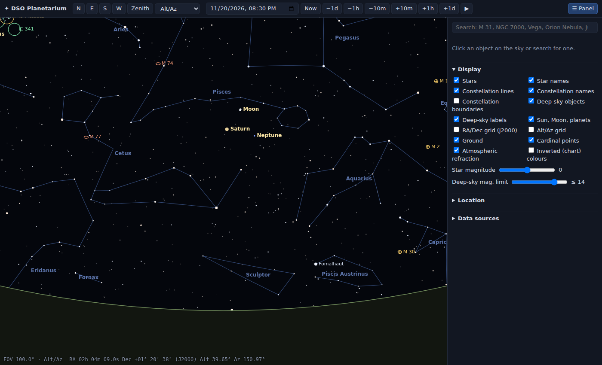
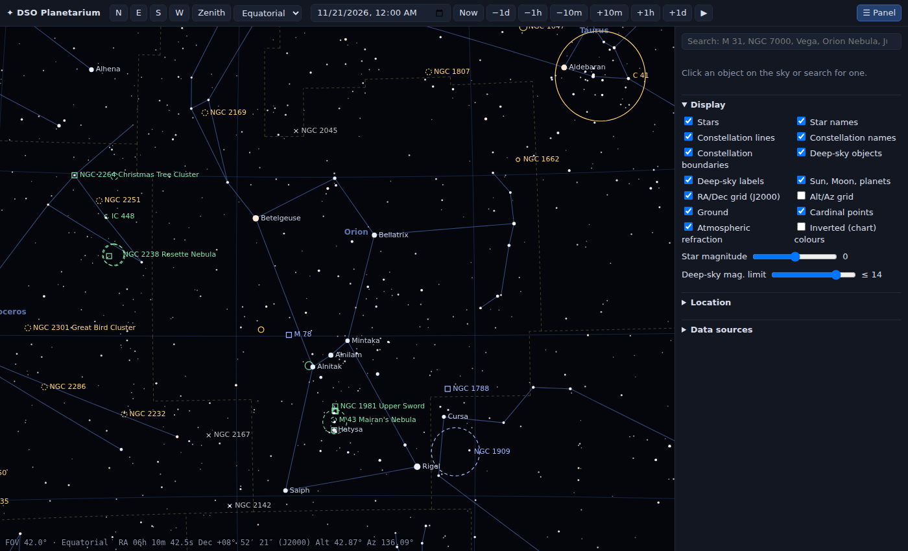
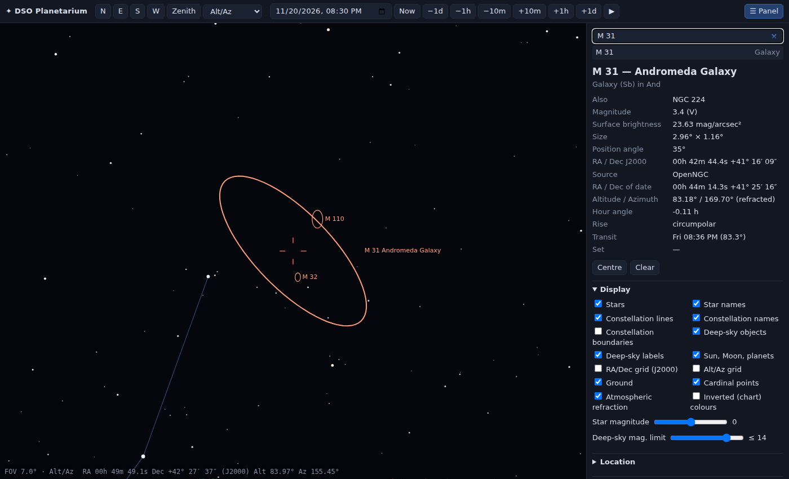
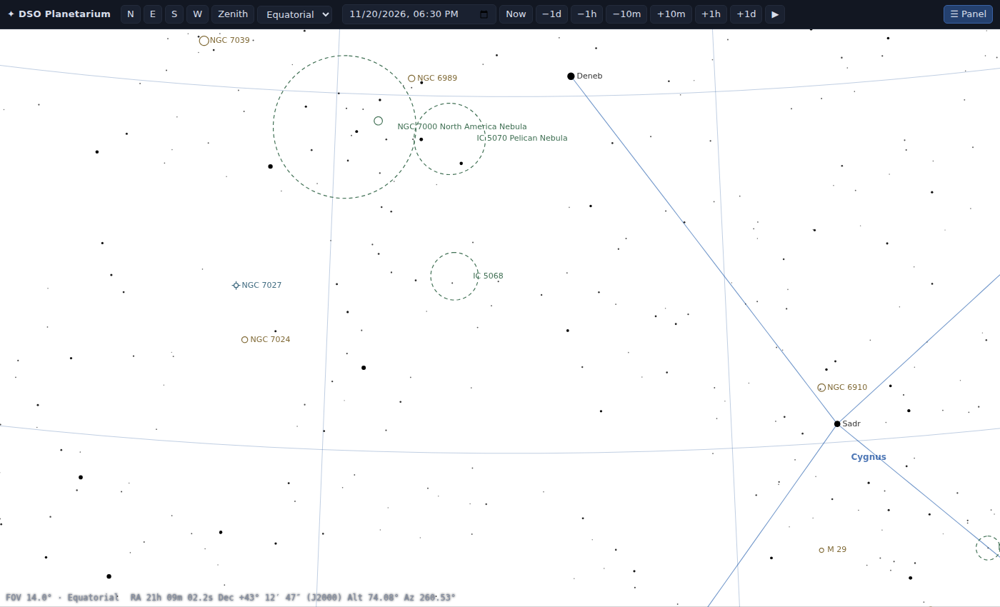
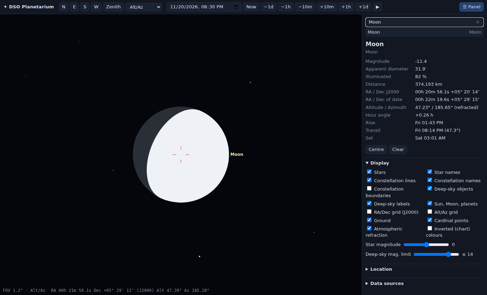
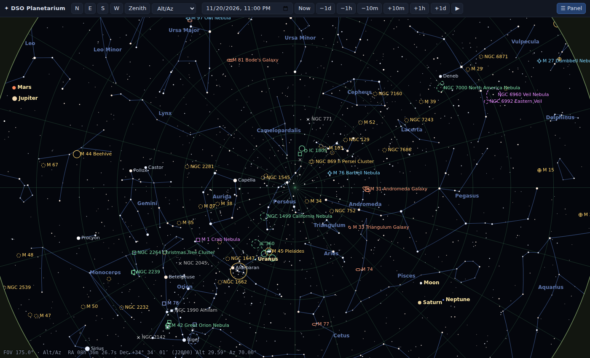

# DSO Planetarium

A precise web planetarium for deep-sky objects. FastAPI only serves the files; all astronomy runs in the browser
(`static/js/astro.js`) and every point is drawn on a 2D canvas through an exact stereographic projection.

## Screenshots

<p>
  
  
</p>

*Left: Alt/Az view to the south with the opaque ground — nothing below the horizon shows through.
Right: Equatorial view of Orion with the J2000 grid and IAU boundaries; dashed outlines have no catalogued position angle.*

<p>
  
  
</p>

*Left: M 31 at its true size (177.8′ × 69.7′) and position angle 35°, with M 32 and M 110; the side panel shows positions,
altitude and rise / transit / set. Right: inverted chart colours, side panel hidden (North America and Pelican nebulae).*

<p>
  
  
</p>

*Left: the Moon at its topocentric size with the phase and the bright limb turned towards the Sun.
Right: the whole sky around the zenith with the Alt/Az grid.*

## Principles

- **One source per kind of data** (see [`static/data/README.md`](static/data/README.md)):
  stars = Hipparcos, deep-sky = OpenNGC, constellations = Stellarium "modern" (lines by HIP number, IAU boundaries),
  planets = JPL DE440. Nothing is typed in by hand.
- **Exact geometry.** Object outlines are computed on the sphere from OpenNGC's major/minor axis and position angle and
  then projected point by point, so sizes, orientation and projection distortion are correct at any zoom. When OpenNGC
  has no position angle, the object is drawn as a dashed circle of its major axis instead of a guessed ellipse.
  Constellation lines are great circles between the Hipparcos stars they connect.
- **Rigorous positions.** J2000 → proper motion → annual aberration → precession (IAU 1976) and nutation → sidereal time
  → horizon → refraction (ERFA model above 15°, Sæmundsson below). Sun, Moon and planets are topocentric. Verified against astropy + DE440 (`tests/`):
  stars < 5″, Sun and planets ≈ 3″, Moon ≈ 13″, refraction < 0.5″ above 15°.
- **Ground is opaque.** In the Alt/Az view nothing below the horizon is drawn through the ground, labelled or clickable.

## Features

- Alt/Az view (horizon level) and Equatorial view (celestial north up, sky fixed while time runs)
- Zoom from 200° down to 3′; drag to pan (the grabbed point stays under the cursor); wheel zooms at the cursor
- 117 955 Hipparcos stars with B−V colours, magnitude limit following the zoom; IAU star names
- 13 372 OpenNGC objects (all Messier, NGC, IC + addendum) with true outlines, type colours and labels
- Constellation lines, names and IAU boundaries; RA/Dec (J2000) and Alt/Az grids; ground and cardinal points
- Sun, Moon (with correct phase and bright-limb orientation) and planets with true angular sizes
- Time: date/time, Now, ±10 min / 1 h / 1 day steps, run time ×60
- Right side panel (toggle with **☰ Panel** or **P**): search, object details (positions J2000 / of date, Alt/Az,
  hour angle, rise / transit / set, size, PA, magnitude, source), display options, location
- Keyboard: arrows pan (Shift = fine), + / − zoom, **P** panel, **Esc** clear selection
- Settings and view are remembered in the browser

## Run

```bash
python3 -m venv .venv
.venv/bin/pip install -r requirements.txt
.venv/bin/uvicorn app.main:app --reload
```
Open <http://127.0.0.1:8000>. Docker: `docker compose up -d --build` → <http://localhost:5210>.

## Rebuild the data

```bash
.venv/bin/python tools/build_data.py --download /tmp/dso-src          # Hipparcos, OpenNGC, Stellarium
.venv/bin/pip install jplephem numpy
curl -O https://naif.jpl.nasa.gov/pub/naif/generic_kernels/spk/planets/de440s.bsp
.venv/bin/python tools/build_ephemeris.py --bsp de440s.bsp --check
```

## Tests

```bash
.venv/bin/pip install -r requirements-dev.txt
.venv/bin/playwright install chromium        # for the UI tests (skipped when Chromium cannot start)
DE440S=de440s.bsp .venv/bin/pytest          # without DE440S the planets are checked against astropy's builtin theory
```

| file | checks |
|---|---|
| `test_astro.py` | stars, Sun, Moon, planets vs astropy / DE440; Sun rise / transit / set; refraction; proper motion |
| `test_geometry.py` | outline size and position angle on the sphere; projection inverse, field of view, east/west; data integrity |
| `test_ui.py` | nothing shows through the ground (labels, picking, selection), opaque ground, side panel toggle, search + true size on screen, view-mode switch, speed (< 60 ms / frame) and heap growth (< 5 MB over 300 frames) |

## Layout

```
app/main.py            static file server (+ /api/health)
static/index.html      page, style.css
static/js/astro.js     time scales, precession, nutation, aberration, refraction, Sun, Moon, planets
static/js/projection.js stereographic projection, inverse, zoom at cursor
static/js/sky.js       canvas renderer: stars, constellations, boundaries, deep-sky outlines, bodies, ground, labels
static/js/app.js       UI: navigation, time, search, side panel, details, rise/transit/set
static/data/           generated data (see its README)
tools/                 data builders
tests/                 accuracy tests (astropy, DE440) and geometry/data tests
```

## Licenses

Code MIT. OpenNGC data CC-BY-SA-4.0. Stellarium sky culture data GPL-2.0-or-later. Hipparcos: ESA. DE440: JPL.
