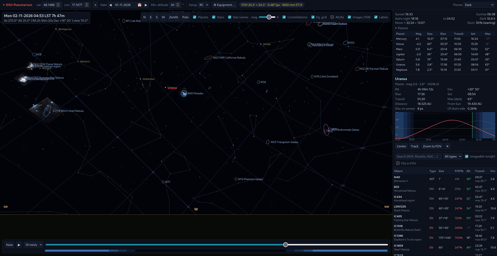
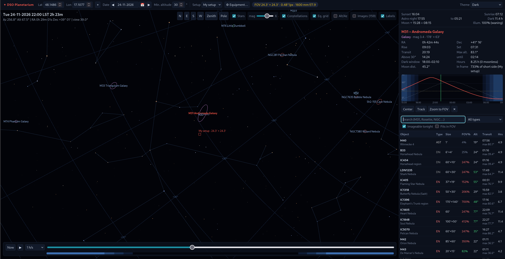
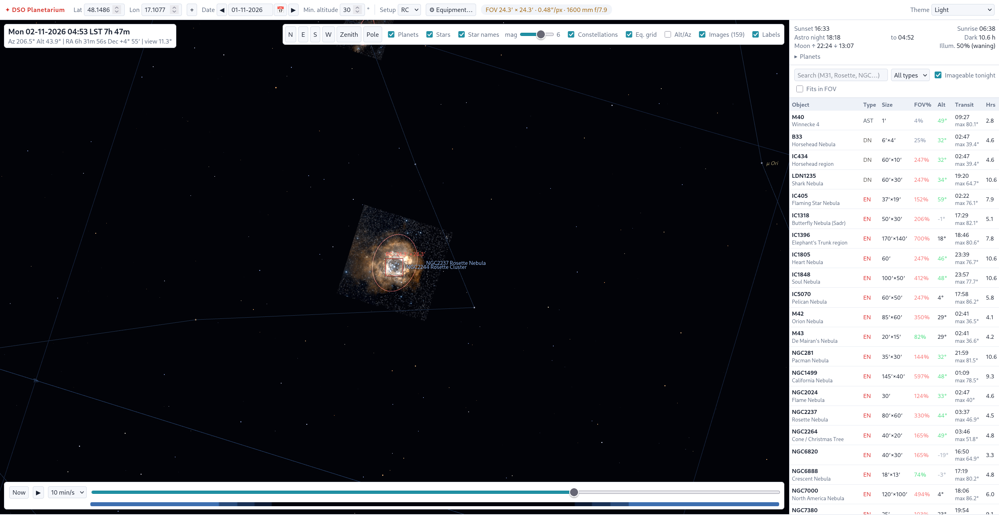
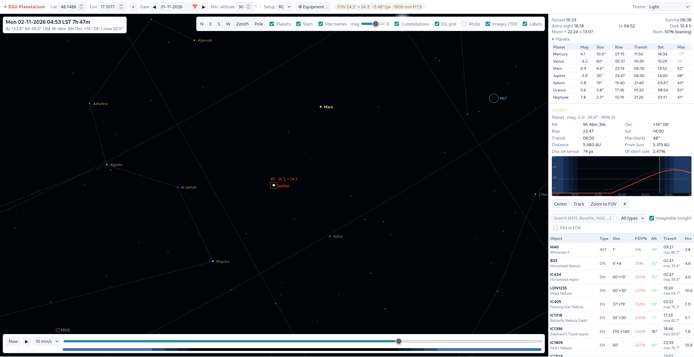
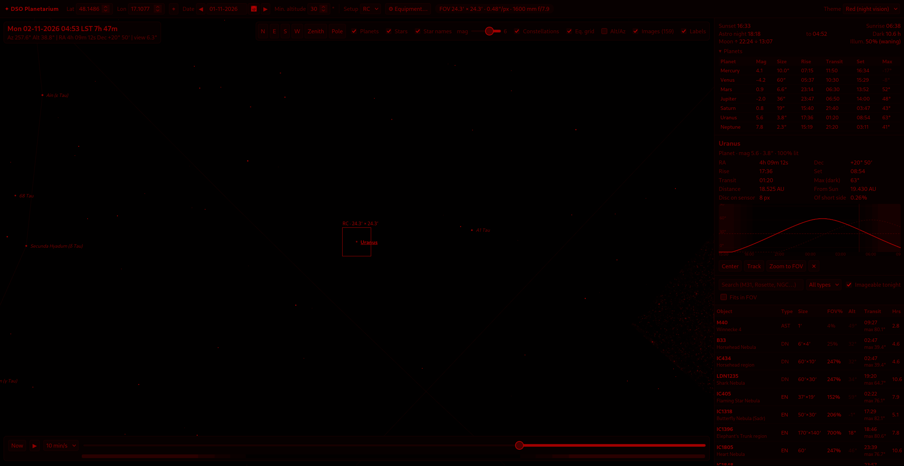
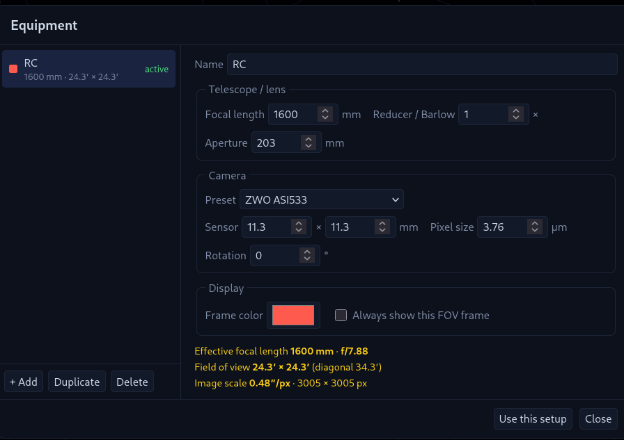
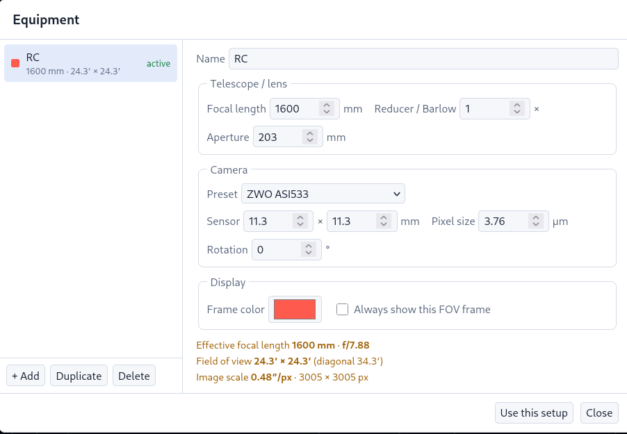

# DSO Planetarium

A web-based planetarium and planner for **deep-sky astrophotography**, built with FastAPI and Three.js.
It focuses on what an imager needs: where deep-sky objects are, when they rise, transit and set, how long
they stay high in true darkness, and how they fit the field of view of your telescope + camera.

  

## Screenshots


*Dark theme: deep-sky objects with true sizes and DSS images, star names, constellations, Uranus selected with its planet detail.*


*Object table, night summary and M31 with its nightly altitude chart.*


*Light theme: Rosette Nebula with a local DSS2 image and the FOV frame of a 1600 mm RC + ASI533.*


*Planets: Jupiter centred in the FOV frame, disc size on the sensor, rise/transit/set for all planets.*


*Red theme for use at the telescope — the whole UI and the sky are rendered in red only.*

<p>
  
  
</p>

*Equipment dialog: setups with focal length, reducer, camera preset, and computed FOV, f-ratio and image scale.*

## Features

**3D sky**
- Observer-centred celestial sphere with horizon, cardinal points, zenith and celestial-pole markers
- Equatorial grid, optional Alt/Az grid, constellation lines
- ~41 000 stars down to mag 8 with B−V colours; limiting magnitude slider that deepens as you zoom
- Names of bright stars (proper names; Bayer designations when zoomed in)
- Sun, Moon (with illumination) and planets Mercury–Neptune with true angular sizes
- Drag to look around, mouse wheel to zoom from 110° down to 0.15°

**Deep-sky objects**
- Catalog: all 110 Messier objects + ~50 popular NGC/IC/Sh2 imaging targets
- Each object drawn as an ellipse with its real angular size and position angle, colour-coded by type
- Local sky images (DSS2 colour) overlaid at the correct scale and orientation
- Labels placed to the right of each object, like Stellarium/KStars

**Planning**
- Time slider across the night, "Now", animated playback; twilight bar (civil / nautical / astronomical)
- Night summary: sunset/sunrise, astronomical darkness, dark hours, Moon rise/set and phase
- Object table: current altitude, transit time and max altitude, imageable hours (dark + above min. altitude),
  object size as % of the sensor; sort, search, type filter, "imageable tonight", "fits in FOV"
- Object detail: rise/transit/set, time above minimum altitude, dark window, moonless hours,
  distance from the Moon, nightly altitude chart with Moon curve
- Planets table with magnitude, size, rise/transit/set and max altitude in darkness
- Center / track / zoom-to-FOV for any object or planet

**Equipment**
- Equipment dialog with any number of telescope + camera setups: focal length, reducer/Barlow, aperture,
  sensor size (camera presets), pixel size, rotation, frame colour
- Computed effective focal length, f-ratio, FOV, image scale (″/px) and resolution
- Active setup shown as a FOV frame; other setups can be shown simultaneously as dashed frames

**UI**
- Dark, Light and Red (night-vision) themes — press **T** to cycle
- Date as dd-mm-yyyy with calendar and previous/next-night buttons
- Settings and setups are remembered in the browser (localStorage)

## Quick start

```bash
python3 -m venv .venv
.venv/bin/pip install -r requirements.txt
.venv/bin/uvicorn app.main:app --reload
```
Open <http://127.0.0.1:8000>.

The page loads Three.js from the jsDelivr CDN; everything else (catalog, stars, images) is served locally.

## Images

Images live in `images/`, the file name is the object ID: `images/M31.jpg` (jpg / png / webp).

Optional sidecar `images/M31.json` for your own photos:
```json
{"fov": 3.2, "rot": 15, "ra": 10.68, "dec": 41.27}
```
| key | meaning | default |
|---|---|---|
| `fov` | image width in degrees | 1.6 × object size |
| `rot` | rotation of north from the top edge towards east, degrees | 0 |
| `ra`, `dec` | image centre, degrees J2000 | object position |

Fill the folder with DSS2 images from NASA SkyView (Red + Blue composed into colour locally):
```bash
.venv/bin/python tools/download_images.py                      # whole catalog
.venv/bin/python tools/download_images.py --only M31 M42 --px 1024 --force
```
Existing files — including your own photos — are never overwritten without `--force`.

## Project layout

```
app/
  main.py        FastAPI app and API endpoints
  astro.py       Sun/Moon/sidereal time, rise-transit-set, darkness window (no dependencies)
  catalog.py     deep-sky catalog (easy to extend)
  images.py      local image index
static/
  index.html, style.css, app.js   UI and 3D scene
  astro.js       client-side astronomy incl. planets (JPL Keplerian elements)
  data/          stars, star names, constellation lines
tools/
  download_images.py
images/          object images
```

## API

| endpoint | description |
|---|---|
| `GET /api/catalog` | object catalog and type names |
| `GET /api/night?lat&lon&start` | Sun twilight times, Moon rise/set/illumination, dark hours |
| `GET /api/visibility?lat&lon&start&min_alt&twilight` | night summary + per-object visibility |
| `GET /api/images` | objects with a local image and its fov/rotation/centre |
| `GET /api/image/{id}` | the image file |

`start` is the beginning of the 24 h window (local noon) in ISO 8601.

## Accuracy

Computations are self-contained and intended for planning, not for pointing:
Sun ≈ 0.01°, Moon ≈ 0.3°, planets ≈ 1′ (valid 1800–2050), rise/set ≈ 1–2 min.
Catalog coordinates are J2000 without precession (≈ 0.35° offset in 2026); object sizes are approximate.

## Data credits

- Stars, star names and constellation lines: [d3-celestial](https://github.com/ofrohn/d3-celestial) © 2015 Olaf Frohn,
  BSD 3-Clause License — see [`static/data/LICENSE-d3-celestial.txt`](static/data/LICENSE-d3-celestial.txt); derived from Hipparcos/Tycho (ESA)
- Images: Digitized Sky Survey (DSS2) via [NASA SkyView](https://skyview.gsfc.nasa.gov/) — see the DSS acknowledgement terms
- Planetary elements: E. M. Standish, *Keplerian Elements for Approximate Positions of the Major Planets* (JPL)
- Planet magnitudes: Mallama & Hilton (2018)

## License

[MIT](LICENSE) © 2026 krse

The MIT license covers the source code of this project. Bundled third-party data keep their own licenses
(see *Data credits* above and [`static/data/README.md`](static/data/README.md)).
